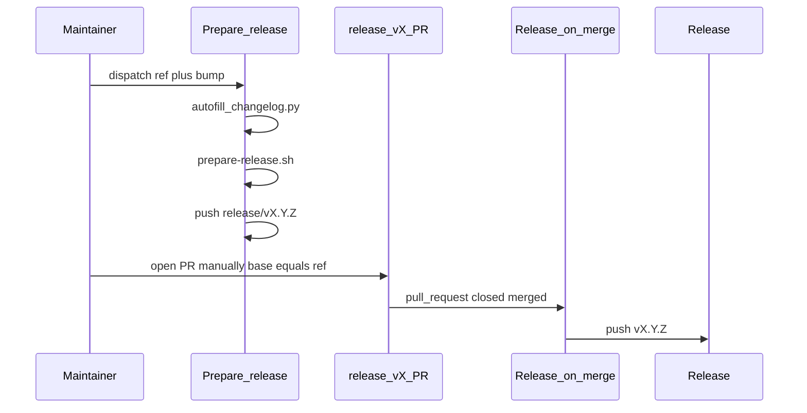
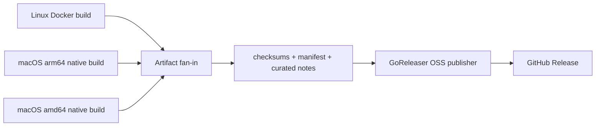

# 003 — CLI release process (design)

## Workflows

| Workflow | Trigger | Outcome |
|----------|---------|---------|
| **Prepare release** | `workflow_dispatch` | Autofill → bump VERSION → finalize CHANGELOG → push `release/vX.Y.Z` |
| **Release on merge** | `release/v*` PR merged to `main` or `release/**` | Push `vX.Y.Z` tag |
| **Release** | Push tag `v*`, or `workflow_dispatch` with an existing exact SemVer tag | Embed builds, checksums, manifest, GoReleaser-published GitHub Release (title = tag; body = `CHANGELOG.md` `[VERSION]` section via `extract-changelog-section.py`) |
| **Create release tag** | `workflow_dispatch` | Manual/dry-run tag (escape hatch) |

## Scripts

| Script | Role |
|--------|------|
| [`scripts/autofill-changelog.py`](../../../scripts/autofill-changelog.py) | Fill missing `[Unreleased]` bullets from merged PRs / git since last tag |
| [`scripts/prepare-release.sh`](../../../scripts/prepare-release.sh) | Semver bump + finalize CHANGELOG section |
| [`scripts/validate-release-tag.sh`](../../../scripts/validate-release-tag.sh) | Shared tag validation for create-release and release-on-merge |
| [`scripts/check-coverage.sh`](../../../scripts/check-coverage.sh) | Enforce `COVER_MIN` against `coverage.out` from `make test-cover` |

## CI test job

The `test` workflow job runs `make build-go test-cover-check vet`. On pull requests it also runs `make test-diff-cover-check` against the merge base. Package scope and exclusions for the coverage gate are defined in `Makefile` (`GO_COVER_PKGS`, `COVER_MIN`, `DIFF_COVER_MIN`); see **REQ-08** and **REQ-09** in `requirements.md`.

## Autofill sources

1. `gh pr list --state merged --base {ref}` when `gh` and `GITHUB_TOKEN` are available.
2. Fallback: `git log {since_tag}..HEAD --merges --first-parent` parsing `#NNN` from merge subjects.

## Branch naming

| Pattern | Meaning |
|---------|---------|
| `release/v0.1.1` | Ephemeral prepare branch (VERSION/CHANGELOG bump); PR opened manually |
| `release/0.1.x` | Long-lived stabilization / patch line (merge base for prepare PRs) |

## Permissions

- **Prepare release:** `contents: write`
- **Release on merge:** `contents: write`
- **Release build/test jobs:** `contents: read`
- **Release publish job:** `contents: write`
- Concurrency group `release-tag` prevents double tag push

## GoReleaser integration

The release workflow uses an **OSS hybrid** design:

1. Existing Make/Docker/native jobs remain the source of the three embedded-Python
   binaries. They run on the target operating system and retain the current smoke
   tests.
2. The fan-in job generates `checksums.txt`, `manifest.json`, and curated
   `release-notes.md` exactly as before.
3. A version-pinned GoReleaser OSS invocation publishes those five pre-existing
   files through `release.extra_files`.

The GoReleaser configuration deliberately skips its build and checksum pipes. The
existing artifacts are not GoReleaser-native build artifacts; treating them as
`extra_files` is the OSS-compatible way to preserve the current multi-runner build.
GoReleaser's prebuilt importer and split/merge pipeline are Pro-only.

The GoReleaser dist directory is separate from `dist/`, because `release --clean`
must not delete the downloaded release binaries before publishing them.
Manual recovery dispatches validate the input before checkout, accept only an
exact `v<semver>` tag, and check out `refs/tags/<tag>` with persisted Git
credentials disabled.

### Why not replace the platform builds

Release binaries contain a target-native relocatable CPython and `cisco-aibom`
bundle. A normal cross-platform GoReleaser matrix cannot build those bundles from
one runner. Moving build ownership into GoReleaser requires either a licensed
prebuilt/split-merge pipeline or a separately validated redesign of the embedded
Python build. ADR 0003 records this boundary.
